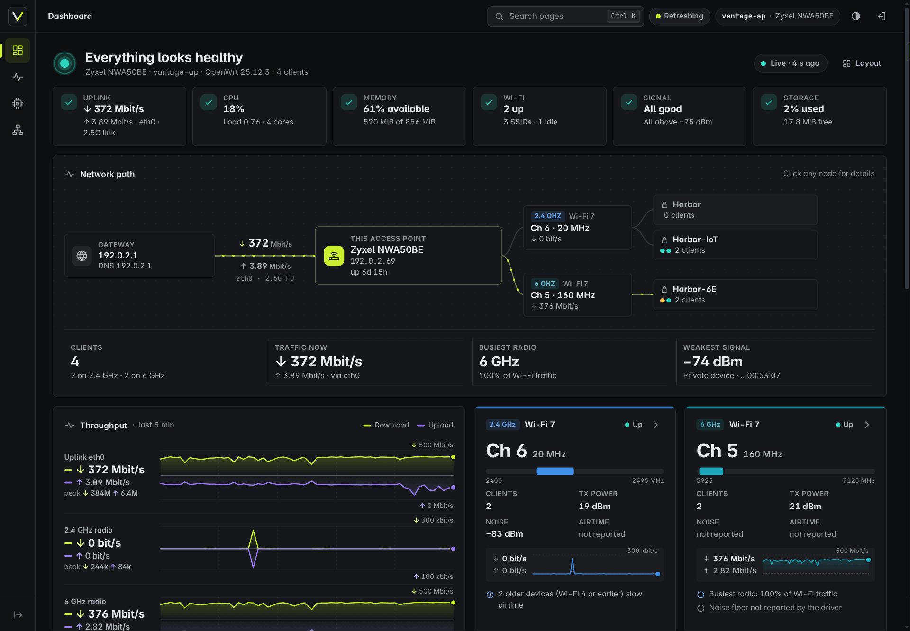
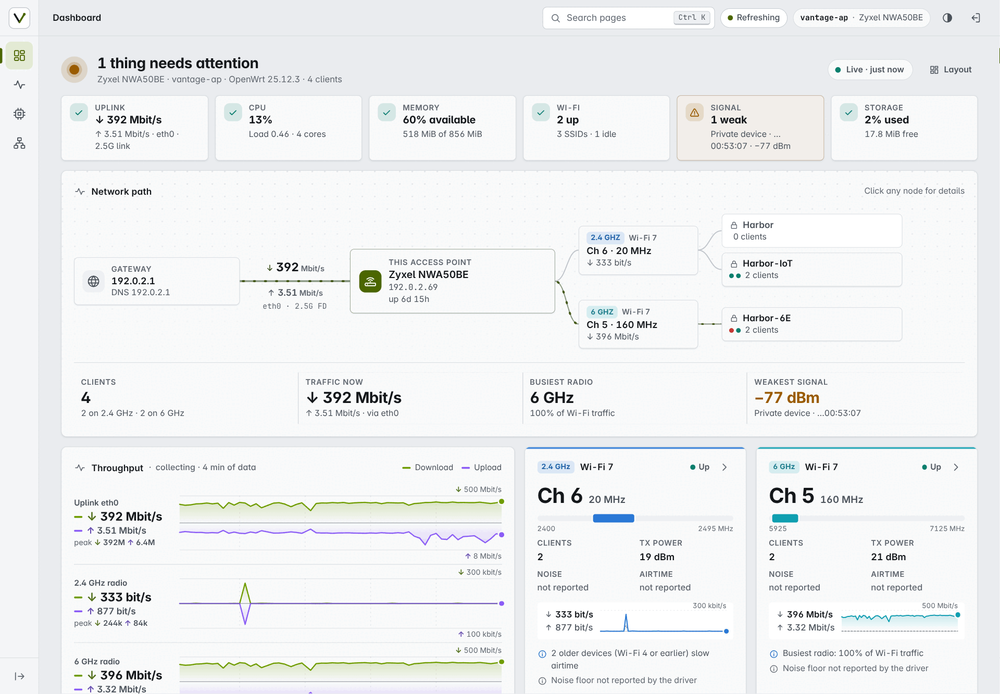

# BYTE by ACE — AW1000 Firmware

A maintained, tested custom firmware for the **Arcadyan AW1000** (`ipq807x`), built on
ImmortalWrt 25.12.1 (kernel 6.12.94) with the Quectel vendor QMI stack and QCA NSS acceleration.

Cellular, WiFi, the RJ11 phone port, SMS, TTL spoofing, the proxy stack and remote access
all work out of the box — no setup wizards, no manual feed patching.

[](../../releases/latest)
[](https://openwrt.org/toh/arcadyan/aw1000)
[](https://github.com/immortalwrt/immortalwrt)
[](#)



---

## Contents

- [Quick start](#quick-start)
- [Features](#features)
- [Changelog](#changelog)
- [Technical reference](#technical-reference)
- [Troubleshooting](#troubleshooting)
- [Credits](#credits)

---

## Quick start

| | |
|---|---|
| **Download** | [Latest release](../../releases/latest) |
| **WiFi** | SSID `BYTE` on 2.4 GHz and 5 GHz — open, no password |
| **Web UI** | <http://192.168.1.1> |
| **Login** | `root`, no password |
| **SIM** | insert, boot — APN is negotiated automatically |

> **Set a root password and a WiFi key immediately after flashing.** Both ship open so a
> fresh install is reachable without hunting for a sticker.

### Flashing

```sh
sha256sum -c sha256sums
sysupgrade -n BYTE_by_ACE-FINAL-25.12-qualcommax-ipq807x-arcadyan_aw1000-squashfs-sysupgrade.bin
```

- `-n` discards `/etc/config` — recommended when coming from another firmware.
- First install or recovery: use `...-squashfs-factory.ubi`.
- Non-destructive test: boot `...-initramfs-uImage.itb` straight into RAM.

---

## Features

### Cellular
- **qmodem** with the Quectel vendor QMI driver (`qmi_wwan_q`)
- Auto-dial on boot, **APN `auto`** — negotiated from the SIM, works on any carrier
- **USB port auto-detection** — the preset targets slot `4-1`; if the modem enumerates
  elsewhere (e.g. `3-1`), the scan finds and dials it
- Dual-stack, with live signal, band, temperature and voltage in LuCI
- **TTL / Hop Limit rewrite** on the modem uplink, any value 1-255 (default 64),
  with a LuCI switch (Network → Modem → TTL Configuration). The switch also
  drives offload: **TTL on → `flow_offloading=1`, TTL off → `0`**. Read the
  caveat below: a software-offloaded flow is only rewritten on its first
  packet, so TTL is not honoured for the life of that flow
- MTU 1420 applied on every redial

### WiFi
- `BYTE` on both radios, open by default
- 5 GHz channel 149 HE80 · 2.4 GHz channel 1 HE20
- 802.11k/v so clients move to the better radio
- NSS WiFi offload

### Phone (RJ11)
- Skyworks Si32261 SLIC DSP patch pre-installed
- PCM auto-checked and forced to slave mode
- Dial tone, ringing, DTMF, Caller ID, hold, speed dial, blocked numbers, call history
- HD wideband audio, SIP calling through QModem voice, ring patterns, DND,
  history retention — all **off by default**
- Upstream `openwrt-aw1000-phone` **v0.7.0** (kernel driver 0.3.0), built in-tree
  against the image kernel `6.12.94` — the same series upstream publishes its
  kmod for, so the port is not a guess

### Proxy
- **passwall2** pre-configured, Xray core
- DNS via chinadns-ng + nftset, transparent TCP/UDP

### Remote access
- **Tailscale** — no longer in the image. It ships in the self-hosted repository:
  `opkg install tailscale luci-app-tailscale-community`. The gate service is still in the
  image, so tailscaled starts only after credentials exist.

### BYTE panel
- One integrated page (menu **BYTE**) with the firmware's own controls:
  - **AdGuard Home**: install-and-wire button (vendored `openwrt-agh-passwall2`
    settings script), start/stop/restart, autostart, setup log, and a direct link
    to AdGuard's own UI
  - **DNS chain** as configured right now: dnsmasq port, AdGuard DNS port,
    PassWall2 DNS and whether its redirect is off (the correct state)
  - **System** strip: firmware, model, kernel, uptime, load, memory, WAN address,
    opkg feed state
  - shortcuts to Dashboard, Netstat, Modem and Firewall
### System
- **Footstrap** theme by default (Bootstrap also shipped); Vantage was dropped
- Modem info panel (JS view, on-demand AT sampling — no cron, no daemon),
  AW1000 LED control, CPU frequency, traffic stats, web terminal
- BBR + `fq`, BDP-sized TCP buffers, zram swap, pinned CPU governor
- **Boot-time self-check** that verifies the tuning actually applied
- **Dashboard widgets** (luci-mod-dashboard): mobile signal, temperatures and
  NSS offload cards, plus **Netstat** (live per-interface throughput and the
  vnStat history) under Tools → Netstat

### Install on demand

These are kept out of the image so it stays small, and install cleanly from the configured
feeds:

```sh
opkg update
opkg install luci-app-banip          # ad/blocklist filtering
opkg install luci-app-smartdns       # fast DNS resolver
opkg install luci-app-homeproxy      # sing-box proxy
opkg install luci-app-mwan3          # multi-WAN failover
opkg install luci-app-sqm            # traffic shaping
opkg install luci-app-openclash      # clash/mihomo
opkg install luci-app-adguardhome    # DNS + ad blocking (matching binary published by us)
opkg install luci-app-nikki          # mihomo
opkg install tailscale luci-app-tailscale-community   # remote access
```

`luci-app-adguardhome` is the one app upstream feeds cannot supply on their own: the UI
needs a newer `adguardhome` than ImmortalWrt 24.10 carries, so the binary is published
alongside it.

---

## Changelog

Complete history, newest first. Every entry names the symptom it cures.
### 2026-11-02 — next
**TTL and NSS are now a user choice**
| Change | Detail |
|---|---|
| **TTL app from QModem** | `luci-app-qmodem-ttlfw4` replaces `byte-ttl`: one UCI switch (`qmodem_ttl.main.enable`) and one value (`qmodem_ttl.main.ttl`, 1-255). LuCI: Network → Modem → TTL Configuration. The old service wrote a better-placed rule (`oifname wwan0_1` vs `iifname br-lan`), but it could not stop ECM, so it could not coexist with NSS |
| **Kernel pinned to 6.12.94** | Built from release tag `v25.12.1`. Reason is hardware, not taste: the AW1000 phone driver (openwrt-aw1000-phone v0.7.0) is published and validated against 6.12.94 — the same kernel NoobWRT's RJ11 images use — and it is compiled in-tree here. The ECM 6.12 series was also written against 6.12.9x. Override with `TARGET_BRANCH=openwrt-25.12` (6.12.112) or `v25.12.2` (6.12.103) |
| **TTL rule fixed for router-originated traffic** | Upstream's `iifname br-lan` postrouting rule only matched packets that came from the LAN, so dnsmasq/NTP/proxy/health-check packets left with the host TTL. Our `/etc/init.d/qmodem_ttl` override keeps the same UCI schema and ECM parking, and matches `oifname "wwan*"` in the same hook: forwarded **and** locally-originated egress, still never LAN or loopback |
| **ECM stays out — deliberately** | `kmod-qca-nss-ecm` is not in the image, the same choice XT-Martinez/aw1000-feed makes: his config selects `NSS_DRV_*` but never `kmod-qca-nss-ecm`, so his `48_nss` widget is dormant too. The widget ships unchanged and stays hidden, because it needs `/sys/kernel/debug/ecm/ecm_nss_ipv4/accelerated_count`. Reasons: ECM 12.5.2024.11.06 does not build on 6.12.112 (`ecm_bond_notifier.c`, `struct bond_cb`), so enabling it would freeze the image on a kernel the phone driver is not validated against, and ECM forwards past netfilter so it defeats the TTL rewrite. NSS data-path acceleration (drv, rmnet raw-IP, NSS WiFi) is unaffected |
| **TTL ↔ offload trade, stated plainly** | Policy is explicit: **TTL on → `flow_offloading=1`, TTL off → `flow_offloading=0`** (hw stays 0, `nss-dp` does not implement it). The cost of that choice: a flowtable entry is created by the first packet, and every later packet of that flow skips netfilter, so the mangle chain never sees it and the TTL stays whatever the sender chose. Clients that already send 64 look correct; a Windows host (128) leaks 128 for the life of each offloaded flow. Router-originated traffic and the first packet of every forwarded flow are always rewritten — which is what the carrier's fingerprinting usually looks at |
| **luci-app-byte** | New vendored package: one page for the firmware's own services. AdGuard Home install/start/stop and its DNS wiring (the `Ace1337z/openwrt-agh-passwall2` settings script, vendored and pinned — never fetched at runtime), the live DNS chain, and a system strip. Backend is an rpcd exec plugin with a narrow ACL; the browser never gets a shell. Built so later cards drop into the same grid without leaving gaps |
| **NSS widget left dormant** | `48_nss.js` ships byte-identical to upstream and stays hidden: no ECM, no debugfs counter. Intentionally never enabled |
**Packages**
| Change | Detail |
|---|---|
| **Modem info rewritten** | The Lua template + controller + cron job are gone: `luci-app-modeminfo` is now a JS view over an rpcd exec plugin. AT is sampled **on demand** and cached for the configured interval, so nothing runs when the page is closed; the old per-minute crontab is removed (it kept the tty busy and woke the modem). Signal quality is shown as RSRP/RSRQ/SINR/RSSI bars with thresholds, 5G NSA/SA metrics, carrier aggregation, cell ID/MCC/MNC, temperature, firmware and IMEI, with the AT port and refresh interval editable in the header. Values are published atomically (`/tmp/modeminfo` rename), one collector at a time (`flock`) |
| **Promotion badges removed** | Upstream put “If you like my work” Star/Sponsor/Telegram shields in the panel, with `img.shields.io` fallbacks. All three SVGs and the text are deleted, and CI forbids them from returning: a router UI on an isolated LAN must not phone an external image host |
| **Firmware version in Status** | Status → Overview now reads `BYTE 25.12(6.12.94) 1.2.1` instead of `BYTE by ACE 25.12 FINAL`. The patch number is derived, not typed: it is the commit count since `FW_BASE` in `version.env`, so **every commit moves it by one** (1.2.1 → 1.2.2 → …). The kernel part is read from `include/kernel-version.mk` of the tree being built, so it cannot drift from the image. See [Firmware version](#firmware-version) |
| **Footstrap logo replaced** | `logo.svg` / `logo_48.png` / `app-icon-192.png` / `manifest.json` are overridden in `files/` (applied after the theme package): the "B" mark with the BYTE accent bar instead of the LuCI logo, and the PWA name is BYTE instead of LuCI |
| **Netstat added** | `luci-app-netstat` vendored in `packages/`. Its `LUCI_DEPENDS:=+vnstat` is unresolvable here: ImmortalWrt 25.12 ships `vnstat2`, which `CONFLICTS` with `vnstat` and does **not** declare `PROVIDES:=vnstat` (upstream added that later). Depending on the bare name made defconfig drop the whole app without a word, so it now depends on `+vnstat2` |
| **vnStat history survives reboot** | Stock `DatabaseDir` is `/var/lib/vnstat`, which is tmpfs — every reboot wiped the database. Repointed to `/etc/vnstat` (overlay) by `byte-vnstat-db`, which also migrates an existing DB and re-asserts the path after a package upgrade |
| **QModem 2.8.9 to 3.3.0** | Latest stable. No `qmodem_runtime` protocol exists anywhere in the 3.3.0 tree, so `wan` is still plain `proto=dhcp`. Scan/probe timing pinned in `/etc/config/qmodem`; `use_ubus 1` now that `ubus_at_daemon` is a hard dependency, so dial, SMS and the phone port share one AT serialiser |
| **Phone 0.4.1 to 0.7.0** | HD wideband audio, SIP through QModem voice (both off by default), caller-ID modes, ring patterns, do-not-disturb, history retention. `at_port 'auto'` replaces the pinned `ttyUSB2`, which dies after a modem reset renumbers the ports |
| **Vantage removed** | Footstrap only: one JS theme instead of two, and no `luci-app-vantage` dashboard competing with the dashboard widgets |
| **Dashboard widgets** | Ported from XT-Martinez/aw1000-feed onto `luci-mod-dashboard`: mobile signal, temperatures, NSS offload. Data comes from `/tmp/aw1000-status`, written by `byte-status-cache` through qmodem's at-daemon — the widgets never send AT, so open dashboards cost nothing |
**Tuning**
| Change | Detail |
|---|---|
| **Packet steering on** | `packet_steering '1'` with `steering_flows '32768'`: one CPU per RX queue/NAPI thread instead of one core taking every interrupt. The modem's xhci IRQ is still immovable, so `byte-affinity` keeps spreading wwan *processing* with RPS on top |
| **Bigger NAPI budget** | `netdev_budget` 600 to **2400**, `netdev_max_backlog` 2000 to **16384**: a WiFi burst now drains in one softirq round instead of being rescheduled, and the per-CPU backlog no longer drops it first |
| **BBR/FQ polish** | Explicit `tcp_rmem`/`tcp_wmem` tables so autotuning has the right ceiling, `tcp_notsent_lowat=131072` so BBR's pacing queue does not become bufferbloat, `rps_sock_flow_entries=32768` to match `steering_flows` |
| **Tailscale out of the image** | ~10 MB binary plus ~13 MB RSS for a feature most units never configure. Now published in the opkg repo; `byte-tailscale-gate` stays in the image so an install still starts tailscaled only with credentials |
| **Dashboard mobile-traffic fixed** | The widget's `uplinks()` matched `proto=quectel`, which only exists in quectel-cm builds. QModem dials plain `dhcp` on `wwan0_N`, so the card always said "Standby" and the traffic card had no device names. Now matches the l3 device too |
| **TFO both ways** | `tcp_fastopen=3`: client side saves a round trip on every upstream reconnect, server side helps LuCI/dropbear logins; the blackhole timer is capped at 60 s so a middlebox that eats cookies stops hurting |
**Checked, unchanged**
| | |
|---|---|
| Image compression | Already the fastest available: squashfs **gzip** (`include/image.mk` offers only gzip or xz, and xz decompresses several times slower on A53) and a **libdeflate-gzip** kernel. Deliberately left alone |

### 2026-10-26 — FINAL

**Cellular**

| Problem | Cause | Fix |
|---|---|---|
| No carrier, WAN dead, empty modem panel on some units | qmodem was hardcoded to USB slot `4-1`, but some modems enumerate on `3-1`. The scan found nothing at `4-1`, disabled the slot, and never dialed | Preset keeps `4-1` (the common case) and **USB auto-scan is enabled**, so a modem on another port is detected and dialed |
| Log spam `sh: invalid number '0x'`, blank LuCI modem page | Empty cell ID ran `printf "%d" "0x"`, which busybox aborts on | Hex conversion guarded; the optional leading `b` marker is stripped |
| Large transfers and calls stall, small packets pass | Cellular MTU was 1500, which an LTE/NR bearer cannot carry | Pinned to **1420**, re-applied on every redial |

**Package manager**

| Problem | Cause | Fix |
|---|---|---|
| `Signature check failed` for our feed | jsDelivr served a stale `Packages.sig` | Feed now points at **`raw.githubusercontent.com`** by default — no manual `sed` needed |
| `opkg update` fails, nothing installable | Signing key installed *after* the image was compiled | Key installed **before** the build |
| AdGuard Home uninstallable | UI needs a newer binary than upstream feeds carry | Binary published alongside the app |

**HTTP/3**

| | |
|---|---|
| **QUIC support** | `curl`/`libcurl` built with HTTP/3 (nghttp3 + ngtcp2 on OpenSSL). `curl --http3` works |

**Stability & speed**

| Fix | Detail |
|---|---|
| **Hourly stall removed** | A crontab entry ran `drop_caches` and `swapoff -a && swapon -a` every hour, forcing 433 MB of zram to decompress and re-compress. Removed; the kernel reclaims on its own. A CI guard blocks it from returning. |
| **Tuning is now verifiable** | `byte-selfcheck` logs the observed CPU governor, qdisc, MTU, RPS mask and sysctl values against what the image configures, then prints `PASS n checks` or `FAIL n mismatches`. Re-runs on every cellular ifup. |
| **Phone v0.4.1** | Newer upstream call handling and fixes, pinned to the release tag |
| **Defconfig no longer aborts** | The `packages` feed branch moved and added a `weechat-full`/`mihomo-alpha` variant cycle, breaking `make defconfig` before anything compiled. The non-default variants are removed at build time and a CI guard keeps them out |

### Earlier fixes

**Internet & connectivity**

| Problem | Cause | Fix |
|---|---|---|
| "Internet is fine but I can't browse" | Carrier hands out an IPv6 prefix without a routable address; clients prefer IPv6 and every connection hangs | IPv6 health check measures real connectivity and falls back to IPv4 only when IPv6 is genuinely unusable — restores automatically |
| Latency spikes after idle | A read-only kernel key aborted `sysctl -p` mid-file, so latency tuning never applied | Removed; all 33 remaining keys verified accepted |
| Device OOM-kills the proxy | zram configured for `lz4`, which this kernel lacks — silently shipped with zero swap | Switched to `lzo-rle`; 433 MB compressed swap now live |
| WAN page shows "no preset" | qmodem's `hang()` deletes the interface sections and the dial worker may never recreate them | `qmodem-iface-heal` recreates `wan`/`wanv6` on boot and on a timer |
| Single-core ceiling at ~500 Mbit/s | All modem interrupts landed on one CPU | `byte-affinity` spreads RPS/RFS/XPS across all four cores |
| Feed URLs 404 | Feed list hardcoded; enabled feeds drifted from published ones | Derived from `.config` — a feed can never be enabled without being published |
| Build not identifiable | `DISTRIB_REVISION` was a value shared by every build | Reports `FINAL` |

**Stability & maintenance**

| Fix | Detail |
|---|---|
| **RJ11 no longer stuck at "Waiting for the modem"** | The phone daemon talks AT through `ubus at-daemon`, which was missing entirely. Now shipped with correct boot ordering. |
| **SMS works from LuCI** | Added the SMS app, forwarding daemon and AT backend |
| **Tailscale self-heals** | Detects an empty `tailscale0` after boot and restarts the daemon; does not run at all until you have credentials |
| **Passwall v1 removed** | It and passwall2 fight over the same firewall rules — v1 was always torn down and appeared broken. Only passwall2 ships. |
| **qmodem WAN panel blank** | `override_at_port`/`sms_at_port` pointed at a port that blocks the RG500Q | Both unset; `at_port` uses the port that answers |
| **NSS ECM removed** (superseded 2026-11-02) | Cannot compile on kernel 6.12.112, and offload bypasses netfilter, defeating the TTL rewrite | Removed from the tree at build time; now shipped again with a runtime TTL/NSS switch, see the current changelog entry |
| **CPU/RAM trim** | NSS acceleration took the load off the SoC | `-O2`, `sch_fq`, pinned max clock, fastboot |

**Size**

Removed ~45 MB of packages most users never touch — sing-box, AdGuard Home, hysteria,
naiveproxy, xray/v2ray plugins, OpenClash, ruby, haproxy, argon theme — and published them
to the self-hosted opkg repo instead, installable on demand.

---

## Technical reference

### Network defaults

| Interface | Device | Proto |
|---|---|---|
| `wan` | `wwan0_1` | `dhcp` |
| `wanv6` | `@wan` | `dhcpv6` — health-checked |
| `lan` | `br-lan` | `192.168.1.1/24` |

### qmodem

```
at_port    /dev/ttyUSB3     # the port that answers on this modem
use_ubus   1                # one AT serialiser (ubus_at_daemon) for dial/SMS/phone
apn        auto             # works on any carrier
pdp_type   ipv4v6
enable_usb_scan 1           # dial whatever port the modem actually lands on
```

`override_at_port` and `sms_at_port` are deliberately unset — pointing them at
`/dev/ttyUSB2` makes `tom_modem` block forever on the RG500Q, which appears as an empty
modem panel and "Disconnected" while the link is actually up.

### Custom services

| Service | Problem it solves |
|---|---|
| `qmodem_ttl` (from luci-app-qmodem-ttlfw4) | Writes the TTL/HopLimit nft rule, and parks `qca-nss-ecm` while it is active |
| `byte-mtu` | Pins the cellular MTU to 1420, re-applied on every netifd `ifup` |
| `byte-v6` | Measures real IPv6 connectivity before demoting to IPv4 |
| `byte-selfcheck` | Verifies governor, qdisc, MTU, RPS and sysctl took effect; re-runs on ifup |
| `qmodem-iface-heal` | Recreates `wan`/`wanv6` when qmodem's `hang()` deletes them |
| `byte-affinity` | RPS/RFS/XPS across all four cores for modem traffic |
| `byte-tailscale-gate` | Starts `tailscaled` only when credentials exist |
| `byte-vnstat-db` | Keeps the vnStat database in `/etc/vnstat` (overlay), not `/var/lib/vnstat` (tmpfs) |
| `byte-status-cache` | Writes `/tmp/aw1000-status/*` for the dashboard widgets via qmodem's at-daemon |

### Firmware version
```
BYTE 25.12(6.12.94) 1.2.1
\___/ \___/ \______/ \___/
  |     |       |      +-- patch   = commits since FW_BASE, derived
  |     |       +--------- kernel  = read from include/kernel-version.mk
  |     +----------------- release series
  +----------------------- name
```
Rendered from `CONFIG_VERSION_DIST`, `CONFIG_VERSION_NUMBER` and
`CONFIG_VERSION_CODE`, because base-files writes
`DISTRIB_DESCRIPTION='%D %V %C'` and LuCI prints that string verbatim.

- `version.env` holds `FW_MAJOR`, `FW_MINOR`, `FW_BASE`, `FW_PATCH_FALLBACK`.
- The patch is `git rev-list --count FW_BASE..HEAD`, so **no manual bump**: the
  commit that adds a change is the version that ships with it (first commit →
  `1.2.1`, next → `1.2.2`). CI checks out with `fetch-depth: 0` for this.
- Without git history (tarball, shallow clone) or with HEAD still on `FW_BASE`
  and uncommitted changes, `FW_PATCH_FALLBACK` is used.
- Raise `FW_MINOR` only for a deliberate feature release; reset `FW_BASE` to
  the release commit and `FW_PATCH_FALLBACK` to its patch number.
- Override for a one-off build: edit `version.env`, or set the three
  `CONFIG_VERSION_*` values before `make defconfig`.

### Tuning

Declared in `files/etc/sysctl.conf`, `files/etc/config/cpufreq` and the `byte-*` services:

- Congestion control **BBR** over **`fq`** (pacing, lower latency under load)
- Socket buffers sized to the link's bandwidth-delay product (4 MB cap)
- `tcp_slow_start_after_idle=0`, keepalive 120/15/4, `netdev_budget=2400`, `netdev_max_backlog=16384`
- `tcp_fastopen=3`, `tcp_notsent_lowat=131072`, packet steering `1` with 32768 steering flows
- CPU governor **`performance`**, min = max, so the first packet after idle is not delayed
- MTU 1420 on `wwan0`/`wwan0_1`, re-applied on every redial
- zram swap, `lzo-rle`, 433 MB

**Known ceiling:** the modem's USB interrupt (`xhci-hcd:usb3`) is not spread across
cores — writes to its IRQ affinity make the kernel collapse it back to one CPU, so
`byte-affinity` leaves it alone and distributes packet *processing* with RPS instead.
The interrupt itself stays on a single core. XPS is written but rejected by
`qmi_wwan`; `byte-affinity` probes this once at boot and logs `xps=unsupported`.

---

## Troubleshooting

### `opkg update` reports a signature failure

The image points the feed at `raw.githubusercontent.com` directly, so this should not
happen. If it does, force a clean refresh:

```sh
sed -i 's|https://cdn.jsdelivr.net/gh/Ace1337z/AW1000_BYTE@repo|https://raw.githubusercontent.com/Ace1337z/AW1000_BYTE/repo|g' /etc/opkg/distfeeds.conf
rm -rf /var/opkg-lists
opkg update
```

Success looks like `Signature check passed` for every feed and `Signature check failed`
nowhere. Only then will `opkg install` work.

### Modem does not dial

```sh
logread | grep -i qmodem
uci show qmodem | grep slot
```

The self-check and qmodem both log the slot they found. If the modem sits on a different
USB port, `enable_usb_scan` should pick it up within ~15 s of boot.

### Did the tuning apply?

```sh
logread -e byte-selfcheck
```

Prints one line per check and a final `PASS n checks` or `FAIL n mismatches`.

---

## Credits

- [ImmortalWrt](https://github.com/immortalwrt/immortalwrt) — base distribution
- [FUjr/QModem](https://github.com/FUjr/QModem) — modem management
- [Perz3us/openwrt-aw1000-phone](https://github.com/Perz3us/openwrt-aw1000-phone) — RJ11 driver
- [qosmio/nss-packages](https://github.com/qosmio/nss-packages) — NSS packages
- [Openwrt-Passwall](https://github.com/Openwrt-Passwall) — passwall2
- [nikkinikki-org/OpenWrt-nikki](https://github.com/nikkinikki-org/OpenWrt-nikki) — nikki
- [dotywrt/dotycat-package](https://github.com/dotywrt/dotycat-package) — AW1000 LED control
- [XT-Martinez/aw1000-feed](https://github.com/XT-Martinez/aw1000-feed) — dashboard widgets
- [NoobLK/luci-app-netstat](https://github.com/Ace1337z/luci-app-netstat) — Netstat app
- [SolomonRicky/luci-app-modeminfo](https://github.com/Ace1337z/luci-app-modeminfo) — modem info

### Licensing

- **Skyworks ProSLIC DSP patch** — proprietary, not redistributable.
- **QCA NSS driver and firmware** (QSDK 12.5) — Qualcomm licence applies.

Review both before republishing any image built from this repository.

<details>
<summary>Screenshots</summary>



</details>
