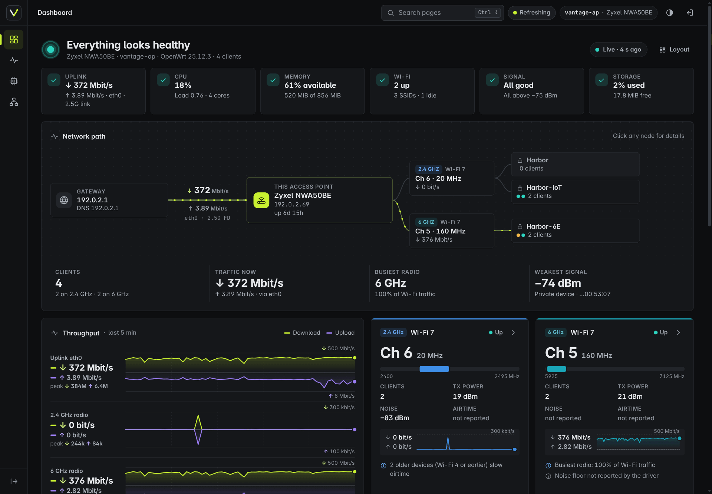
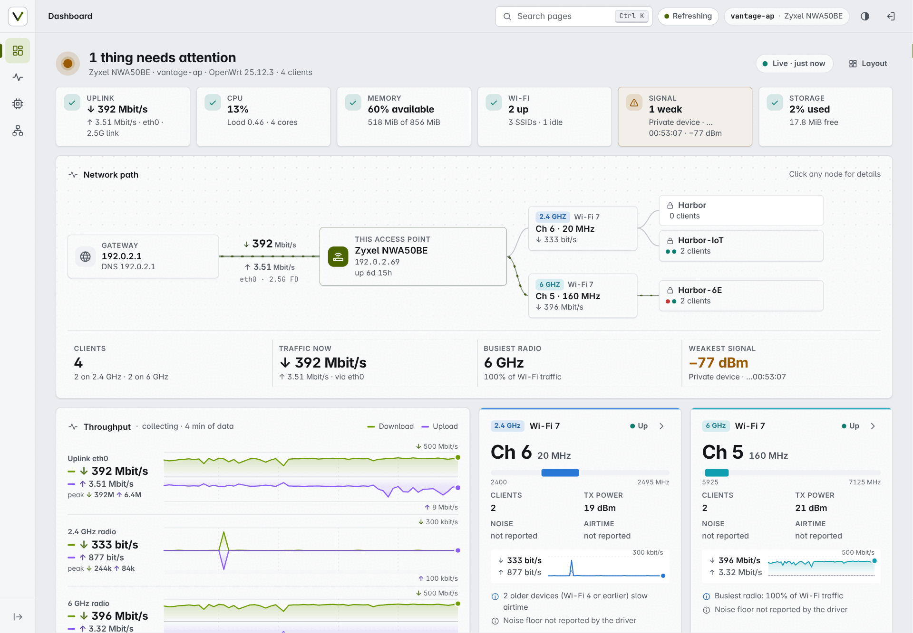

# BYTE by ACE — AW1000 Firmware

**The most complete, tested and maintained custom firmware for the Arcadyan AW1000.**

Flash once. Everything works — cellular, WiFi, the RJ11 phone port, SMS, TTL spoofing, proxy
and remote access — pre-configured, verified on real hardware, and maintained.

[](../../releases/latest)
[](https://openwrt.org/toh/arcadyan/aw1000)
[](https://github.com/immortalwrt/immortalwrt)
[](#)



---

## Why this firmware

Most AW1000 builds leave you to work things out alone: the modem doesn't dial, the phone
port stays silent, TTL leaks, or `opkg update` silently fails and nobody tells you why.

**BYTE by ACE is different — every one of those problems was found on real hardware and
fixed.** Not guessed at, not patched around. Verified, with the failure documented in the
commit history so it can never come back.

| | |
|---|---|
| **It just works** | Modem dials on boot, WiFi is up, phone rings, TTL is correct. No setup wizards. |
| **Actually tested** | Every release is verified on a live AW1000 with a real SIM — boots, dials, proxies traffic. |
| **Fixed, not hidden** | 28 documented fixes since the last public build. Each one names the symptom it cures. |
| **Small** | 44 MB image. We removed ~45 MB of packages most people never use. |
| **Guarded** | CI refuses to build if any critical setting regresses. |
| **Honest** | Problems are written down instead of discovered by you at 2 AM. |

---

> ## 🚨 IMPORTANT — read this before installing any package
>
> **If `opkg update` reports "Signature check failed", run these three commands.** Your
> router is not broken and nothing is corrupt — our package feed is served through jsDelivr,
> which can hand out a stale signature file. Point the feed at GitHub directly:
>
> ```sh
> sed -i 's|https://cdn.jsdelivr.net/gh/Ace1337z/AW1000_BYTE@repo|https://raw.githubusercontent.com/Ace1337z/AW1000_BYTE/repo|g' /etc/opkg/distfeeds.conf
> rm -rf /var/opkg-lists
> opkg update
> ```
>
> **Success looks like:** `Signature check passed` for every feed and `Signature check
> failed` nowhere. Only then will `opkg install` work.

---

## Quick start

| | |
|---|---|
| **Download** | [Latest release](../../releases/latest) |
| **WiFi** | SSID **`BYTE`** on 2.4 GHz and 5 GHz — open, no password |
| **Web UI** | <http://192.168.1.1> |
| **Login** | user `root`, no password |
| **SIM** | insert, boot, done — APN is negotiated automatically |

> ⚠️ **Set a root password and a WiFi key immediately after flashing.** Both ship open so a
> fresh install is reachable without hunting for a sticker.

### Flashing

```sh
sha256sum -c sha256sums
sysupgrade -n BYTE_by_ACE-FINAL-25.12-qualcommax-ipq807x-arcadyan_aw1000-squashfs-sysupgrade.bin
```

- `-n` discards `/etc/config` — recommended when coming from another firmware.
- First install or recovery: use `...-squashfs-factory.ubi`.
- Non-destructive test: boot `...-initramfs-uImage.itb` straight into RAM.

---

## Changelog — FINAL

The complete list of what was fixed, and why it mattered.

### Internet & connectivity

| Problem users saw | Cause | Fix |
|---|---|---|
| **"Internet is fine but I can't browse"** | Carrier hands out an IPv6 prefix without a routable address; clients prefer IPv6 and every connection hangs | IPv6 health check measures real connectivity and falls back to IPv4 only when IPv6 is genuinely unusable — restores automatically if the carrier starts working |
| Transfers stall, calls drop | Cellular MTU was 1500, which an LTE/NR bearer cannot carry | Pinned to **1420**, re-applied on every redial |
| Latency spikes after idle | A read-only kernel key aborted `sysctl -p` mid-file, so latency tuning never applied | Removed; all 33 remaining keys verified accepted |
| Device OOM-kills the proxy | zram configured for `lz4`, which this kernel lacks — silently shipped with **zero swap** | Switched to `lzo-rle`; 433 MB compressed swap now live |

### Package manager

| Problem users saw | Cause | Fix |
|---|---|---|
| `opkg update` fails, nothing installable | Signing key installed *after* the image was compiled, so image and feed never agreed | Key is now installed **before** the build |
| Feed URLs 404 | Feed list hardcoded; enabled feeds drifted from published ones | Derived from `.config` — a feed can never be enabled without being published |
| AdGuard Home uninstallable | UI needs a newer binary than upstream feeds carry | Binary published alongside the app |

### Stability & maintenance

| Fix | Detail |
|---|---|
| **Phone updated to v0.3.0** | Call history, automatic cleanup of old calls, phone LED no longer disabled by firmware LED settings. Built from upstream — our previous fork had stalled at v0.2.0. |
| **RJ11 no longer stuck at "Waiting for the modem"** | The phone daemon talks AT through `ubus at-daemon`, which was missing entirely. Now shipped with correct boot ordering. |
| **SMS works from LuCI** | Added the SMS app, forwarding daemon and AT backend |
| **Tailscale self-heals** | Detects an empty `tailscale0` after boot and restarts the daemon; no longer runs at all until you have credentials |
| **Passwall v1 removed** | It and passwall2 fight over the same firewall rules — v1 was always torn down and appeared broken. Only passwall2 ships. |
| **Build is identifiable** | `DISTRIB_REVISION` now reports `FINAL` instead of a value shared by every build |

### Size

Removed **45 MB** of packages most users never touch — sing-box, AdGuard Home, hysteria,
naiveproxy, xray/v2ray plugins, OpenClash, ruby, haproxy, argon theme. All 44 MB of the
image is something you will actually use.

---

## Features

### Cellular
- **qmodem** with the Quectel vendor QMI driver (`qmi_wwan_q`)
- Auto-dial on boot, **APN `auto`** — negotiated from the SIM, works on any carrier
- Dual-stack, live signal, band, temperature and voltage in LuCI
- **TTL 64** on IPv4 and IPv6, modem egress only
- MTU 1420 applied on every redial

### WiFi
- **`BYTE`** on both radios, open by default
- 5 GHz channel 149 HE80 · 2.4 GHz channel 1 HE20
- 802.11k/v so clients move to the better radio

### Phone (RJ11)
- Skyworks Si32261 SLIC DSP patch pre-installed
- PCM auto-checked and forced to slave mode
- Dial tone, ringing, DTMF, **Caller ID**, hold, speed dial, blocked numbers, call history

### Proxy
- **passwall2** pre-configured, Xray core
- DNS via chinadns-ng + nftset, transparent TCP/UDP

### Remote access
- **Tailscale** — reach your router from anywhere, no port forwarding

### System
- **Vantage** theme (default), Footstrap and Bootstrap
- Modem info panel, AW1000 LED control, CPU frequency, traffic stats, web terminal
- BBR + `fq`, tuned TCP buffers, zram swap

### Install on demand

Not baked in, so the image stays small. All install cleanly:

```sh
opkg update
opkg install luci-app-banip          # ad/blocklist filtering
opkg install luci-app-smartdns       # fast DNS resolver
opkg install luci-app-homeproxy      # sing-box proxy
opkg install luci-app-mwan3          # multi-WAN failover
opkg install luci-app-sqm            # traffic shaping
opkg install luci-app-openclash      # clash/mihomo
```

`banip`, `smartdns`, `homeproxy`, `mwan3`, `sqm` and `openclash` come from the official
ImmortalWrt feeds. These two are published by us:

```sh
opkg install luci-app-adguardhome    # DNS + ad blocking (with a matching binary)
opkg install luci-app-nikki          # mihomo
```

> `luci-app-adguardhome` is the one app upstream feeds cannot supply: the UI needs a newer
> `adguardhome` than ImmortalWrt 24.10 carries, so we publish the binary alongside it.

---

## Technical detail

### Network defaults

| Interface | Device | Proto |
|---|---|---|
| `wan` | `wwan0_1` | `dhcp` |
| `wanv6` | `@wan` | `dhcpv6` — health-checked |
| `lan` | `br-lan` | `192.168.1.1/24` |

### qmodem

```
at_port    /dev/ttyUSB3     # the port that answers on this modem
use_ubus   0                # no ubus at-daemon in the 2.8.x line
apn        auto             # works on any carrier
pdp_type   ipv4v6
```

`override_at_port` and `sms_at_port` are deliberately unset — pointing them at
`/dev/ttyUSB2` makes `tom_modem` block forever on the RG500Q, which appears as an empty
modem panel and "Disconnected" while the link is actually up.

### Custom services

| Service | Problem it solves |
|---|---|
| `byte-ttl` | Writes the correct `forward`-hook rule matching `oifname wwan0_1`, and re-applies at boot |
| `byte-mtu` | Pins the cellular MTU to 1420, re-applied on every netifd `ifup` |
| `byte-v6` | Measures real IPv6 connectivity before demoting to IPv4 |
| `qmodem-iface-heal` | Recreates `wan`/`wanv6` when qmodem's `hang()` deletes them |
| `byte-affinity` | RPS/RFS/XPS across all four cores for modem traffic |
| `byte-tailscale-gate` | Starts `tailscaled` only when credentials exist |

---

## Credits

Built on the work of others, and standing on their shoulders:

- [ImmortalWrt](https://github.com/immortalwrt/immortalwrt) — base distribution
- [FUjr/QModem](https://github.com/FUjr/QModem) — modem management
- [Perz3us/openwrt-aw1000-phone](https://github.com/Perz3us/openwrt-aw1000-phone) — RJ11 driver
- [qosmio/nss-packages](https://github.com/qosmio/nss-packages) — NSS packages
- [Openwrt-Passwall](https://github.com/Openwrt-Passwall) — passwall2
- [nikkinikki-org/OpenWrt-nikki](https://github.com/nikkinikki-org/OpenWrt-nikki) — nikki
- [dotywrt/dotycat-package](https://github.com/dotywrt/dotycat-package) — AW1000 LED control
- [anothaDev/luci-theme-vantage](https://github.com/anothaDev/luci-theme-vantage) — theme
- [SolomonRicky/luci-app-modeminfo](https://github.com/Ace1337z/luci-app-modeminfo) — modem info

### Licensing

- **Skyworks ProSLIC DSP patch** — proprietary, not redistributable.
- **QCA NSS driver and firmware** (QSDK 12.5) — Qualcomm licence applies.

Review both before republishing any image built from this repository.

<details>
<summary>Screenshots</summary>



</details>
